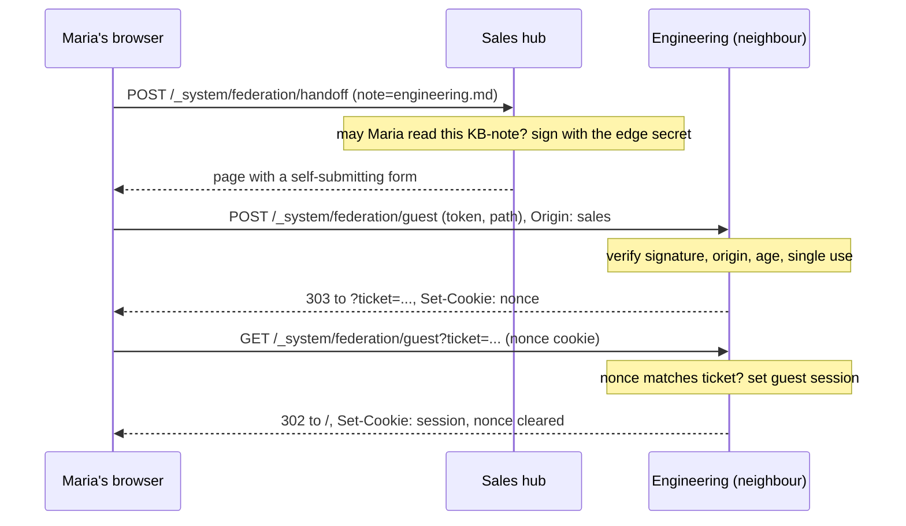

# Federation guest handoff: a person opens a neighbouring base

**Status:** a spike on branch `spike/federation-guest-handoff` (draft PR #518,
marked not for merge). The handoff, the guest session, the read-only guard,
the access scoping and the tests are real code that runs. Faked for the spike:
the guest's identity lives in an existing column of `users` instead of its own
table, replay protection is an in-memory set per process, the "accept guests"
setting is a command-line flag with no admin UI, and the hub cannot tell in
advance whether a neighbour accepts guests. Section 12 lists everything a real
version would need. Nothing here is ready for production.

Words used throughout:

- **Hub** — the instance the employee already uses and is signed in to.
- **Neighbour** (or peer) — the other instance whose notes the employee wants
  to open.
- **KB-note** — a note on the hub whose frontmatter has
  `mcp_federation_kb_url` pointing at the neighbour's MCP endpoint. Today
  agents use it to search the neighbour through MCP.
- **Edge** — one pairing between two instances: an outbound key on the hub and
  an inbound key with the same key id (`kid`) on the neighbour. The neighbour's
  admin decides which subgraphs that key may read.
- **Guest** — a person who arrived on the neighbour through an edge. They have
  a session there, but no account of their own.

## 1. The case

A company keeps its knowledge in several trip2g instances, say one per
department: Sales runs `sales.example.com`, Engineering runs
`eng.example.com`. The two are joined by federation, so an agent working for
Sales can already search the Engineering base through MCP. A person cannot:
the KB-note on the Sales hub is an ordinary page with nothing to click, and
the Engineering site does not know who they are.

The handoff closes that gap. Here is one Sales employee, Maria, who already
has an account on the Sales hub and none on Engineering.

1. **Maria opens the KB-note on her own hub**, for example
   `sales.example.com/engineering`. Because she is signed in and can read
   that note, it shows an **Open knowledge base** button. (A visitor who is not
   signed in sees the same button on a free KB-note, but it is a plain link to
   the Engineering front page and carries no identity.)
2. **She presses the button.** Her browser posts to her own hub. The hub
   checks that she may read this KB-note, signs a short statement — "this
   reader, from this hub, may look at your base" — with the edge's secret,
   and returns a page that immediately posts that statement to Engineering.
   She sees a blank page for a moment.
3. **Engineering checks the statement and answers with a redirect.** It
   checks the signature, that the post really came from the Sales site, that
   the statement has not been used before and is under 30 seconds old. If all
   is well, it finds or creates a guest user for "Maria via the Sales edge",
   puts a one-time nonce in a cookie, and redirects the browser to a
   one-time ticket URL on itself.
4. **The browser follows the redirect.** Engineering checks that the browser
   brought the nonce cookie that matches the ticket, sets an ordinary session
   cookie for the guest, clears the nonce cookie, and redirects to its front
   page `/`.
5. **Maria is now reading Engineering** as a guest. She can open, search and
   download attachments of exactly the notes the Sales edge was granted (see
   section 4 for the precise rule). On a page that is not shared with the
   Sales edge she gets the same closed page any signed-in reader without
   access gets: status 403, the page title, "This page is closed" and
   "Ask the owner of this knowledge base for access, or sign in."
   (the English text of the paywall widget; I did not look at it rendered for
   a guest). The body of the note is not sent.
6. **Engineering may have its own KB-notes**, for example one pointing at the
   Design department. If Maria, as a guest, can read that KB-note, she sees
   the same button and can go one hop further (section 10).

The four requests, from the button press to the guest session:



The two steps on the neighbour exist because of how browsers handle cookies.
The session cookie is `SameSite=Lax`, so a browser does not send it on a POST
that comes from another site. The POST in step 3 therefore cannot see whether
Maria already has her own session on Engineering. The GET in step 4 is a
top-level navigation, the cookie does ride it, and only that request decides
whether to set a guest session (section 6).

Verified in a real browser (Chromium via Playwright, two local instances): the
whole flow above ends in a guest session with the nonce cookie cleared.

**Where in the code:** the button is `KBButton` in
`internal/defaulttemplate/template.go` and the `SelfContent` block in
`internal/defaulttemplate/views.html`; the hub step is
`internal/case/federationhandoff`; the neighbour steps are
`internal/case/federationguest`; the signed statement is
`internal/case/mcp/guest_handoff.go`.

## 2. Is there a button, and what kind

| Who opens the KB-note on the hub | What they get |
|---|---|
| Not signed in, KB-note is free | A plain link to the neighbour's front page, no identity |
| Not signed in, KB-note is not free | The KB-note itself is closed, as today; no button |
| Signed in, can read the KB-note | The handoff button |
| Signed in, cannot read the KB-note | The KB-note is closed, as today; no button |

The button appears whenever the KB-note's URL ends in `/_system/mcp`. The hub
does not know whether the neighbour accepts guests, so the button is shown
even when pressing it will be refused (section 9).

## 3. What each side sets up

**The neighbour's owner (Engineering):**

- Has, or creates, an inbound federation key for Sales — the same key Sales
  agents already use for MCP. Nothing new is needed for the handoff itself.
- Decides which subgraphs that key grants. This list is exactly what Sales
  people will be able to read in a browser (plus the extras in section 4).
- Starts the instance with `--federation-accept-guests`. It is off by
  default. While it is off, every handoff is refused and every open guest
  session stops working on its next request.

**The hub's owner (Sales):**

- Has the outbound key for Engineering (the other half of the same edge).
- Has a KB-note with `mcp_federation_kb_url` set to Engineering's
  `https://.../_system/mcp`. The button opens the site at the same scheme and
  host, so this URL must be the address employees' browsers use (section 9).
- Decides who can read the KB-note. Only people who can read it get the
  handoff button, so the KB-note's own access settings decide which Sales
  employees can cross the edge.
- Has `--public-url` set to the address employees actually see in their
  browser. The hub signs this address into every handoff, and the neighbour
  refuses a handoff posted from any other address.

**Checklist for a company:**

1. Pair each pair of department instances that should see each other
   (Admin → Federation → Add Inbound / Add Outbound, as for MCP).
2. On each neighbour, grant the subgraphs people from that hub may read.
3. Decide what happens to notes with no subgraph and to `require_signin`
   subgraphs (section 4) before turning anything on.
4. On each neighbour that should accept people, add
   `--federation-accept-guests` and restart.
5. On each hub, check `--public-url`, put the KB-note where the right
   employees can read it, and make sure its KB URL is the public address.
6. Use HTTPS on both sides, or plain HTTP on both; an HTTPS hub cannot hand
   off to an HTTP neighbour (section 9).

**Where in the code:** the flag is `FederationAcceptGuests` in
`internal/appconfig/config.go`; the outbound key is found the same way MCP
finds it, `federationPeer` in `cmd/server/federation.go`.

## 4. What a guest can read

A guest's access is computed live, on every request, from the subgraphs
currently granted to the edge they arrived over. Nothing is copied into the
guest's user record. The rule is the one the neighbour already applies to
agents that call it over MCP (`ResolveWithSubgraphs`):

| Note on the neighbour | Edge grants at least one subgraph | Edge grants none |
|---|---|---|
| Free (`free: true`) | readable | readable |
| In a granted subgraph | readable | — |
| In a subgraph that is not granted | closed (403) | closed (403) |
| No subgraph at all | **readable** | closed (403) |
| In a `require_signin` subgraph | **readable** | closed (403) |
| An `.html` page | closed | closed |

The two bold rows surprise people. A note with no subgraph, and a note in a
subgraph that only asks visitors to sign in, are readable by a guest of any
edge that grants anything at all — whichever subgraph that is. This is how
the neighbour already treats MCP callers; the spike did not change it, and a
test pins it (`TestFederationGuestAccessMatrix`, subtest
"unlabelled and require_signin notes").

Consequences in plain words:

- **Access is per edge, not per employee.** Every Sales employee who can read
  the KB-note gets the whole of what the edge grants on Engineering. Their own
  subscriptions on the Sales hub play no part. If the KB-note is free and the
  edge grants a paid subgraph, anyone who signs up on the Sales hub reads that
  paid subgraph on Engineering. The only lever on the hub side is who can read
  the KB-note.
- **Free notes need no handoff.** Anyone can read them anyway.
- **Unlabelled notes leak to every edge.** If Engineering keeps internal notes
  without any subgraph, a guest from any edge that was granted, say, only
  `public-specs` reads all of them.

**Closing unlabelled notes with a frontmatter patch.** A frontmatter patch on
the neighbour can put every note that has no subgraph into a private one, for
example a rule on `**` with this jsonnet (an example; I did not run it):

```jsonnet
if std.objectHas(meta, "subgraph")
  || std.objectHas(meta, "subgraphs")
  || std.get(meta, "free", false)
then {}
else { subgraph: "internal" }
```

After that, no note is unlabelled, so a guest reads only free notes, granted
subgraphs and `require_signin` subgraphs. Two caveats:

- **`require_signin` subgraphs stay open to every edge** with at least one
  grant. The patch does not help there; the only remedy today is not to use
  `require_signin` for anything guests should not see.
- **The patch also changes local access.** Today a local signed-in user with
  any active subscription reads every unlabelled note. After the patch they
  read those notes only if they have the `internal` subgraph. Whether the
  `internal` subgraph is created automatically when a patch names it, I did
  not check (pushing a note that names a new subgraph did create it in the
  demo).

What a guest sees on each read path, all checked by
`TestFederationGuestAccessMatrix` with three guests (an edge granting `paid`,
one granting a subgraph that holds no notes, one granting nothing):

| Read path | Guest is scoped to the edge |
|---|---|
| Page render | yes |
| GraphQL `note` | yes |
| Site search | yes |
| Attachments | yes |
| Note queries (`noteQuery`) | yes |
| Similar notes | yes |
| RSS | the same public feed an anonymous visitor gets |
| MCP | closed to guests (section 5) |
| Sitemap | public notes only, as for everyone |

Two things that look like leaks are not specific to guests. A free note that
embeds a closed note shows the embedded content to every reader, anonymous
included. A custom Jet layout that lists notes with `.All()` instead of
`.Public()` lists every note to every reader.

**Where in the code:** `CurrentFederatedScope` in `cmd/server/auth.go` gives
a guest the edge's live subgraph list; the rule is
`internal/case/canreadnote/resolve_with_subgraphs.go`.

## 5. What a guest cannot do

A guest only reads. One check, "is this a federation guest?", is applied in
two places:

- **GraphQL:** every mutation is refused with "a federation guest can only
  read", except a mutation that does nothing but `signOut`, so a guest can
  leave. This covers form submissions, purchases, issuing personal tokens,
  Telegram linking, favourites, note writes, and every admin mutation.
- **Everything else:** any request from a guest with a method that can change
  something (anything but GET, HEAD, OPTIONS) gets 403, except GraphQL (which
  has its own check above) and the two handoff endpoints. This closes the MCP
  endpoint — without it a guest's browser session would have reached the MCP
  tools, and through them the neighbour's own outbound federation keys — and
  the HAT sign-in POST, form posts and any POST added later.

Not closed, on purpose: the sign-in links that work over GET (`?hat=`, the
HAT GET link, OAuth callbacks, the Telegram sign-in link, the purchase-token
cookie). Each needs its own proof of a real account and replaces the guest
session with that account; none of them attaches anything to the guest user.

The closed page a guest gets on a note outside the edge is the ordinary
paywall: 403, the note title and description, "This page is closed", the
sign-in widget, and any purchase offers. A guest cannot buy (the purchase is a
mutation) and cannot sign in by email while they are a guest (also a
mutation). What the sign-in widget shows to a guest I did not check in a
browser.

**Where in the code:** `appreq.DenyGuest` in `internal/appreq/request.go` is
the check; `refuseGuestMutation` in `internal/graph/handler.go` applies it to
GraphQL, `denyGuestWrites` in `cmd/server/federation_guest.go` to the rest.
Tested by `TestAGuestCannotWrite`.

## 6. Who the guest is on the neighbour

**A synthetic user.** The neighbour keeps one user row per pair "edge,
reader": the first handoff creates it, later ones find it. The row has no
email and no Telegram id. Its `created_via` column holds
`federation:<kid>:<reader hash>`. Every sign-in path in trip2g finds its user
by email or Telegram id, so none of them can reach this row: there is nothing
to type into the email form, no OAuth account maps onto it, and a HAT link
names an email. The guest session itself carries the role
`federation_guest`, which is never an admin, and the edge's `kid`.

**The reader hash.** The hub names the employee as
`sha256(lower(trim(email)))`, as hex. Both sides compute the same value for
the same address, so Engineering can match "this guest from Sales" with "the
same person who once signed in here directly" by hashing its own users'
emails. The price: the hash is not secret. Anyone with the neighbour's
database can test whether a given address visited by hashing it, and a list
of company emails is easy to come by. Treat the hash as an email address with
one extra step, not as a pseudonym.

**A reader with no email** on the hub (for example a Telegram-only account)
is named by `sha256(<hub public URL> + "#user:" + <hub user id>)`. It is
stable for that person on that hub and matches nothing on the neighbour.

**An employee who already has an account on the neighbour.** If their browser
already holds their own session on Engineering, the handoff leaves it alone:
they arrive on the front page as themselves, with their own access, which may
be more or less than the edge grants. Only an existing *guest* session is
replaced. If they are signed out of Engineering, they become a guest like
anyone else; their own account is not used. A hub that sends a hash equal to
the hash of a local user's email — even an admin's — still gets a separate
synthetic guest row (`TestAReaderIDCannotLandInALocalAccount`).

**Where in the code:** `FederationGuestUser` in
`cmd/server/federation_guest.go`; the hash in `readerAndHop` in
`internal/case/federationhandoff/resolve.go`.

## 7. Analytics

Guest page views land in the same tables as every signed-in reader's:
`user_note_views` (one row per view) and `user_note_daily_view_counts` (a
counter per user and note). Because the guest is a real row in `users`,
nothing else had to change
(`TestAGuestPageViewIsRecordedUnderTheSyntheticUserOfTheEdge`).

Despite its name and its `day` column, `user_note_daily_view_counts` is
keyed on user and note only, nothing resets it, and the recording stops
adding rows to `user_note_views` once that counter reaches 100. So after a
person has opened one note 100 times, further views of it are not recorded
at all. This is how view recording already works for every user
(`recordUserNoteViewTx` in `cmd/server/misc.go`, the
`UpsertUserNoteDailyView` query); read in the code, not tested.

"Which guests from which hub read which notes" is one query today:

```sql
select u.created_via, np.value as note, count(*) as views
  from user_note_views v
  join users u          on u.id = v.user_id
  join note_versions nv on nv.id = v.version_id
  join note_paths np    on np.id = nv.path_id
 where u.created_via like 'federation:%'
 group by u.created_via, np.value
 order by views desc;
```

`created_via` names the edge by its `kid`, not by the hub's address; the
federation secrets list in the admin maps a `kid` to the hub. There is no
admin page or GraphQL field for this; it is SQL only.

Two caveats:

- **A refused page is recorded as a view.** The note page records the view
  before it checks access, for every signed-in reader, not only guests. A
  guest who opens a note outside the edge and gets 403 still adds a row. Read
  in `internal/case/rendernotepage/resolve.go` (`handleUserToken` runs before
  `CanReadNote`); not covered by a test.
- **Nothing reaches Prometheus.** There are no metrics for handoffs, refusals,
  guest sessions or guest views.

## 8. How the handoff is protected

**Signature with the edge secret.** The hub signs the statement with the same
secret its agents use for MCP calls to that neighbour, and the neighbour
verifies it with the same code it uses for those calls. Without the secret
nobody can produce a statement, so nobody can choose the reader, the hop
count, the target page or the origin.

**The `use` claim.** The statement is marked `use: guest`. The MCP endpoint
refuses any token that carries a `use`, and the guest endpoint refuses any
token that does not. This stops the statement — which sits for a moment in the
employee's browser, readable by them — from working as a 30-second MCP bearer
token for the whole edge, and stops an ordinary MCP token from opening a guest
session.

**30 seconds, single use.** Each statement expires 30 seconds after signing
and carries a random id the neighbour remembers once used. This stops a
statement copied from a browser, a log or a proxy from being used again.

**Signed origin and the `Origin` check.** The hub signs its own site origin
(scheme, host, port of `--public-url`) into the statement. The neighbour
accepts the POST only when the browser's `Origin` header equals that origin;
a missing `Origin` or `Origin: null` is refused. This stops login CSRF: an
employee who copies their own form onto another site cannot make a
colleague's browser post it and land in the employee's guest session. The
check runs before the statement is spent and before any guest user is looked
up, so a refused post does not burn the real one. Verified in a real browser:
a captured form replayed from a third-party page gets 403 and no cookie.

**Ticket bound to the posting browser.** The ticket URL from step 3 could be
copied and sent to someone else as a link. So the neighbour also sets a
nonce cookie on the POST's response and puts only the nonce's hash into the
ticket; the GET leg opens a session only when the browser brings the matching
cookie. The cookie is `trip2g_guest_nonce`, `HttpOnly`,
`Path=/_system/federation/guest`, `Max-Age=30`, `SameSite=Lax`, and `Secure`
unless `--user-token-insecure` is set. It is cleared on every GET, success or
failure. A ticket is spent only when the nonce matches, so somebody who sees
the URL cannot burn it. Verified in a real browser: a copied ticket URL opened
in another browser profile gets 403, and the poster's own ticket still works.

**An existing session wins.** A browser that already holds its own session on
the neighbour keeps it (section 6). This stops a handoff from silently
replacing someone's real account with a guest.

**Revocation and the setting.** Every request from a guest re-checks that the
edge's inbound key still exists and is not revoked, and that
`--federation-accept-guests` is on. If not, the session ends on the spot: the
request is served as anonymous and the cookie is cleared
(`TestRevokingTheEdgeEndsTheGuestSession`,
`TestTurningGuestsOffRefusesHandoffsAndEndsSessions`).

**Still open:**

- **A hub can mint guests without limit.** Whoever holds the edge secret can
  send any reader hash, and each new hash creates a user row on the neighbour.
  Nothing limits the rate or the number.
- **Replay state is per process and in memory.** Used statement and ticket ids
  live in a set inside one server process. With several processes, or across
  a restart, a statement or ticket can be used once per process inside its
  30 seconds.
- **The hub's word is final.** The neighbour cannot check that the reader is
  who the hub says, only that the hub said it.
- **Two first handoffs at once** for the same reader can create two guest rows
  (no unique key on the pair). Lookups then use the older one; analytics see
  two rows.
- **A non-browser client can set any `Origin`.** That only lets a reader open
  a guest session for themselves, which they could do anyway; it does not
  help against someone else's browser, which never has the nonce.
- **Origin check and nonce binding depend on the browser.** Both are verified
  in Chromium only (see section 9 for what breaks them).

**Where in the code:** signing and verification in
`internal/case/mcp/guest_handoff.go` and `federation_helpers.go`; origin,
replay and nonce checks in `internal/case/federationguest/resolve.go`; the
cookie in `internal/case/federationguest/endpoint.go`. Tested by
`TestTheGuestEndpointRefuses`, `TestAHandoffPostedFromAnotherSiteIsRefused`,
`TestATicketOpensOnlyInTheBrowserThatPostedTheHandoff`.

## 9. When the button leads to a wall

Ways an honest employee presses the button and is refused. Unless marked
otherwise, the refusal is the neighbour's page "This knowledge base didn't
let you in" (403).

- **The neighbour has not turned on `--federation-accept-guests`.** Refused.
  The hub cannot know this in advance, so the button is shown anyway.
- **The neighbour runs an older version** without the guest endpoint. The
  POST lands on its note renderer for a path that is not a note; I expect a
  404 page, but did not run it.
- **The KB URL is an internal address** (`http://10.0.0.5:8081/_system/mcp`,
  a Docker host name). The hub sends the browser to that address, which the
  browser outside the network cannot open. Agents are fine, people are not.
- **The neighbour's site lives on a different host than its MCP endpoint,**
  or the neighbour serves several domains. The session cookie is set on the
  host from the KB URL; on the other domain the employee is not a guest.
- **The hub's `--public-url` differs from the address in the browser**
  (another domain, a port, `http` versus `https`). The signed origin then
  does not match the browser's `Origin` and every handoff is refused.
- **A proxy in front of the hub adds `Referrer-Policy: no-referrer`**, or a
  custom layout adds `<meta name="referrer" content="no-referrer">` to the
  handoff page. Browsers then send `Origin: null` with the form and it is
  refused. The hub's own handoff page sets `strict-origin` for this reason.
  Inferred from the Fetch standard, not tried in a browser.
- **HTTPS hub, HTTP neighbour.** Under `strict-origin` a browser sends
  `Origin: null` when posting from HTTPS to HTTP. Refused. Inferred, not
  tried.
- **Cookies are blocked for the neighbour** (by policy or by the browser).
  The nonce cookie or the session cookie never sticks; refused at the ticket
  step. Inferred, not tried.
- **The navigation takes longer than 30 seconds** between the button and the
  redirect (slow network, a paused tab). The statement or the ticket has
  expired. Refused.
- **The employee is already a guest at the hop limit** (section 10). The hub
  refuses with its own page "Couldn't open the knowledge base".

## 10. Chains

A Sales employee who is a guest on Engineering can press the button on one of
Engineering's KB-notes and go on to Design, if the guest can read that
KB-note under the Sales edge's grant. Engineering signs the new statement
with its own Engineering→Design edge secret, its own origin, the hop count
plus one, and the **reader hash it received from Sales**. Design checks the
post against Engineering's origin, not Sales'.

The hop count starts at 1 for a handoff from a local reader. Each instance
refuses to sign, and refuses to accept, a hop above its own
`--mcp-federation-max-depth` (default 3, the same limit as federated MCP
calls). Tested by `TestTheHandoffGoesOneHopFurtherAndStopsAtTheLimit`.

Whose word Design takes for the reader's identity: Engineering's. Design
cannot see that Sales ever vouched for the person; it trusts Engineering, and
Engineering trusted Sales. A compromised or careless instance in the middle
of a chain can name anyone. The guest on Design is a separate synthetic user
under the Engineering→Design edge, so Design's analytics show the reader as
arriving from Engineering.

## 11. Session lifetime and offboarding

A guest session is an ordinary trip2g session cookie with the guest role. It
lives as long as `--user-token-expires-in`, **30 days by default**, and is
not renewed by activity.

- **The employee is removed from the hub** (account deleted, banned, or loses
  access to the KB-note). Nothing reaches the neighbour. The guest session on
  the neighbour keeps working **until it expires — up to 30 days by
  default.** The neighbour checks the edge on every request, not the person.
  They cannot start a new handoff from the hub.
- **The edge's inbound key is revoked on the neighbour.** Every guest of that
  edge becomes anonymous on their next request (tested).
- **`--federation-accept-guests` is turned off.** Every guest on that instance
  becomes anonymous on their next request (tested). Turning it off is a
  restart, since it is a flag.
- **The guest user is banned on the neighbour.** The existing ban check runs
  for guests too; I did not test what the guest sees.

The edge's subgraph grant is read on every request, so removing a subgraph
from the edge takes effect immediately for every guest.

## 12. What the spike fakes and what a real version needs

- **A `federation_guests` table** `(kid, reader_hash, user_id)` with a unique
  key. Today the pair is a string in `users.created_via`: lookups scan the
  table, and concurrent first handoffs can create duplicates.
- **A marker on `users` for synthetic users,** so the admin user list,
  counts and exports can leave them out. Today they show up as users with no
  email.
- **A capability field in `federationdescribe`** saying whether the neighbour
  accepts guests, so the hub shows the button only when it will work.
- **The setting in the admin UI and per edge,** not one instance-wide flag.
  One neighbour may want people from Sales but not from Support.
- **A site address for the neighbour** in the KB-note or in
  `federationdescribe`, instead of deriving it from the MCP URL (section 9).
- **Shared, persistent replay state** for statements and tickets, so several
  processes and restarts do not reopen the 30-second window.
- **Offboarding that reaches the neighbour,** or a much shorter guest session
  that the hub must renew (section 11).
- **A limit on guest creation per edge,** so a hub cannot fill the
  neighbour's `users` table.
- **A keyed reader id** (an HMAC with a per-edge key) if the privacy of the
  hash matters more than matching the same person across instances.
- **Deep links:** the hub always sends `/`. Opening a specific note on the
  neighbour needs a target chosen by the KB-note or by search.
- **Analytics surface:** an admin view or GraphQL field for guest reads, and
  metrics for handoffs and refusals.
- **A per-request cache** of the edge's subgraph list; today every access
  check is one database query, and search checks every result.

## 13. Decisions left to the owner

1. **Per edge or per reader?** Today every hub employee who can read the
   KB-note gets the edge's whole grant. Options:
   - keep per edge, and use the KB-note's own access as the gate (no new
     code; coarse — one KB-note, one audience);
   - one KB-note and one edge per audience, each edge granting less (no new
     code; more keys to manage);
   - carry the reader's hub subgraphs in the statement and intersect them with
     the edge's grant on the neighbour (new code; the two instances must agree
     on subgraph names, and the neighbour still takes the hub's word for them).
2. **Should a refused page count as a view?** Options: keep it (no change;
   analytics overcount for everyone, guests included); record only after the
   access check (a small change in note rendering that also changes local
   users' analytics).
3. **Unlabelled and `require_signin` notes for guests.** Keep the MCP rule
   (section 4) and close them with patches, or give guests a stricter rule
   than agents get (only free notes and granted subgraphs). The stricter rule
   is a small change, but it makes a guest see less than an agent on the
   same edge.
4. **Plain email hash or keyed hash?** Plain lets two instances recognise the
   same person; keyed protects the address from anyone holding a database.
5. **How long should a guest session live?** The default 30 days is long for
   a person the neighbour cannot offboard. A shorter guest-only lifetime means
   more trips through the button.
6. **Should the handoff exist at all for public neighbours?** For a free
   neighbour the plain link already works; the handoff only matters when the
   edge grants something closed.
