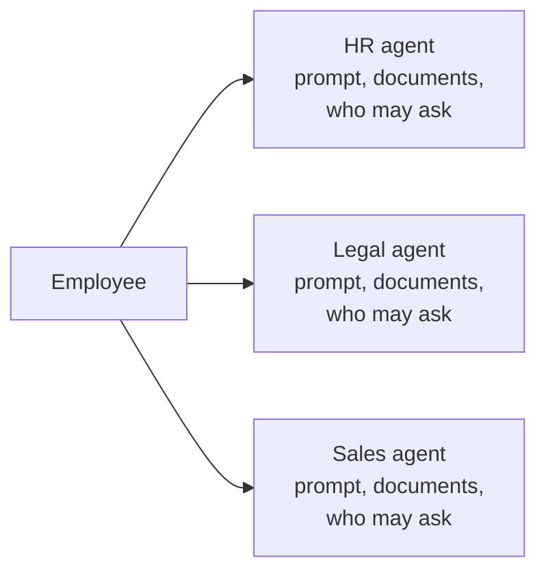
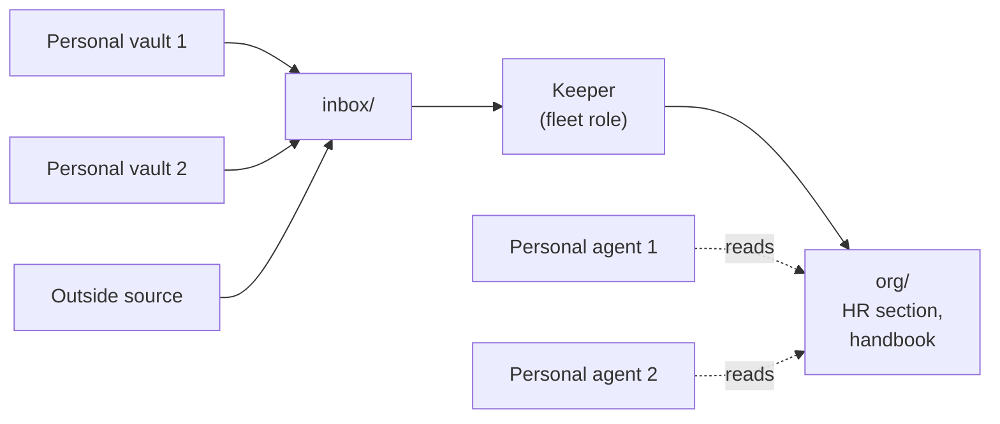

# Nobody writes to the shared place

*What this is: how a company knowledge base is laid out when nobody writes into a common space. Each person writes to their own vault, a keeper agent assembles the level above, and a function like HR turns out to be a section with access. I also mark where trip2g does this today, where it does not, and where my own pipeline breaks the rule. Read it if you are deciding what goes into a shared base and who reads it. If one person writes everything you have, [[en/thoughts/one-writer-per-base]] already covers you.*

## The diagram with an agent per function

When a company draws how AI will work inside it, the first diagram usually looks like this: a box per function. An HR agent, a legal agent, a sales agent. Each box gets a prompt, a pile of documents and a list of people who may ask it.



*The first diagram: an agent for every function.*

Take the "HR agent" box apart and it holds four things.

**Documents.** The vacation policy, the onboarding checklist, the salary bands. These belong in a base.

**Rules for answering.** "Quote the policy, do not paraphrase the salary bands." These belong in the base too. trip2g serves them to any agent that connects, as an [[en/user/instructions_guide|instructions note]].

**A list of who may ask what.** That is read access, and the base already has it.

**Actions.** If the HR agent files a vacation request, that part is a tool, and nothing here replaces it.

Three of the four are a knowledge base with a chat window attached. The person asking usually has an agent already, in an editor, a terminal or a messenger. Someone who has none needs one chat window pointed at the hub with their own access, not one window per function.

So the HR function is a section and an access rule. The agent does not disappear from the diagram. It moves from answering to writing.

## A domain is where the writer changes

How many bases are there? I count writers.

[[en/thoughts/one-writer-per-base|A base has one writer]]: its owner, a person or that person's agent. Everyone else reads. A domain, then, is not a topic and not a department. It is the place where the writer changes. One writer for HR and for the engineering handbook is one domain with two sections. Two writers are two domains, whatever the org chart says.

| Question | What answers it |
|---|---|
| Who writes? | A base per writer |
| Who may search it? | A federation edge between bases |
| What do they see? | Subgraphs inside the base |

The two reading rows are [[en/user/context-separation]]. The writing row is the one a company gets wrong first, by starting from one base for everybody.

How many writers a company has is not something the software decides. The people rolling it out and the heads of the teams decide it. One writer for the whole organisation is a valid answer.

## The keeper

People do not write company pages. They write to themselves: notes, call transcripts, drafts, half a thought before a meeting. A personal vault is a pile, and that is fine, because it has one owner who knows what is in it.

The level above has a writer too, and it is an agent. I call it the keeper. It reads what people chose to hand over, reads outside sources, and writes the assembled pages. There is one keeper per writer, not one per function.



*The second diagram: people write to themselves, the keeper writes the assembled pages, personal agents read them with their owner's access.*

In trip2g a keeper is a [[en/user/fleet|fleet]] role, and a role is a note. The frontmatter says what it may read, what it may write and what wakes it up. The body is the instruction.

```yaml
---
fleet_id: main
model: gpt-5.4-mini
tools: [search, read_note, write_note]
read_patterns: ["inbox/**", "org/**"]
write_patterns: ["org/**"]
mode: change
trigger_on: [create, update]
trigger_include: ["inbox/**"]
---
```

The runtime checks `read_patterns` and `write_patterns` on every call. A keeper with `write_patterns: ["org/**"]` writes nowhere else.

Here is the limit. A fleet role reads and writes inside one hub. So `inbox/` and `org/` are folders of the same instance, and the piles have to arrive there. Several vaults can sync into one instance, each under its own label ([[en/user/advanced|docs]]). A person can move a note by hand. An outside agent can write through [[en/user/update_notes|`updateNotes`]] or the sync CLI. A code role can pull from an outside API on a schedule. The list is not complete, and the hub prescribes none of it.

What does not ship: a fleet role that reads a base on another instance. Federation lets an agent search a peer. It does not feed a keeper.

## Three rules, and the one my pipeline breaks

Three things should hold whichever way the material arrives.

**Only the keeper writes the assembled pages.** Once people fix things there by hand, it is a shared wiki again.

**An assembled page names its source.** In [[en/thoughts/federation-supply-chain]] I watched a model search one merged pile, find the right idea and put it in the wrong mouth.

**A fix goes to the source.** If the assembled page is wrong, then the transcript, the personal note or the role is wrong. You fix that, and the keeper rebuilds.

The keeper I can show is the [[en/user/calls-knowledge-base|calls pipeline]]. Three roles run in a chain. The first pulls call transcripts from the recorder and writes each one verbatim. The second marks topic boundaries. The third pulls out people, tools, projects and terms and writes a note for each. In the demo run the note for a project called "Hermes" collected three mentions from three different calls. Nobody wrote that note. It grew.

It keeps the second rule by quoting. Every topic carries the exact transcript lines under it, with a time range that links back.

It breaks the first. The review step in its own docs says: "fix titles on `needs_review` notes … the pipeline appends, you correct." That is my hand in the assembled pages. It works because the pipeline only appends and never rewrites a note body, so it does not overwrite my correction. It is still the shared-wiki move, one title at a time, and I have not moved that correction to the source.

## What it costs

The assembled level lags. It is as fresh as the keeper's last run.

Inside one instance the single writer is a convention. An API key reaches the whole instance, and nothing stops a person from writing into `org/`. The guarantee exists only between instances, where a peer can do nothing but read, and that is exactly where the keeper cannot reach yet.

A personal pile holds personal things. What the keeper sees is the role's `read_patterns`, and somebody has to set them on purpose. The default should be "nothing".

The hub records which user or API key wrote each version of a note. It does not record which source a sentence came from. Keeping that link is the role's job, and a role that paraphrases without quoting loses it.

A function agent is also one place to see what people ask HR. I give that up.

The costs of the one-writer rule itself, the lost drive-by edit and the shared draft, are in [[en/thoughts/one-writer-per-base|that essay]] and I do not repeat them.

The trade, stated once: you give up the page everybody can edit. You get a company base in which every sentence has an owner, and an HR function that is one section and one access rule.
