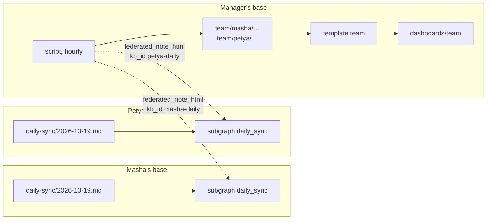

Picture a team where every employee works with their own AI agent (ours is [[en/thoughts/hermes-wiki|hermes]]), and every agent keeps its memory in its own trip2g base. The manager wants to know each morning what the team plans and each evening how the day went. Without a stand-up call, without a form to fill, and without anyone sending a report.

trip2g already has the three pieces this takes: subgraphs, federation and templates. A small script ties them together. This essay walks through it step by step. A runnable version, three bases in Docker and no agents, is [trip2g/federation_team_sync](https://github.com/trip2g/federation_team_sync).

![[team-day-dashboard.png|The manager's page: the team's last three days. Test agents; the oldest day is test data added by hand]]

## Three things in trip2g you need

- **A subgraph** is a named group of notes and the unit of access in trip2g. A note joins one through its frontmatter, `subgraph: daily_sync`. See [[en/user/subgraphs|Subgraphs]]. A [[en/user/frontmatter-patches|frontmatter patch]] sets that field on a whole folder at once, so nobody has to remember it note by note.
- **Federation** lets one base read part of another. The employee's base issues a federation secret, grants it one subgraph, and hands the manager a handover key. The manager's base installs the key and adds a KB-note: a small note that points at the employee's base and gives it a short id, the `kb_id`. From then on the manager's base can read that one subgraph with the `federated_*` MCP tools, addressed by that id, and nothing else of the employee's base. See [[en/user/federation|MCP Federation]].
- **A custom template**, or layout, is your own page for a note, written in Jet and stored as `_layouts/<name>.html`. A note picks it with `layout: <name>`. The template can look up other notes and lay them out however the page needs. See [[en/user/templates|Templates]] and [[en/user/jet-functions|Jet functions]].

## How it fits together



Each employee's base keeps a note per day and opens just those notes to the manager. A script in the manager's base reads them once an hour, keeps a copy, and one template draws the page from the copies.

## Step 1. A note per day in the employee's base

Each employee's base holds one file per day, `daily-sync/YYYY-MM-DD.md`:

```markdown
---
date: 2026-10-19
person: Маша
---

# 2026-10-19 — Маша

## План
- Подготовить КП для «Вектора».
- Обновить прайс в CRM.

## Итог
- КП отправлено, прайс перенесён на завтра.

## Нужна помощь
- Решение руководителя по скидке 10% для «Альфа-Логистик».
```

trip2g does not care who writes it. In our case the agent does: a scheduled job asks the employee in the morning and again in the evening, and the agent turns each answer into a few lines of its own.

## Step 2. Open only those notes to the manager

A frontmatter patch puts the whole folder into one subgraph:

````markdown
---
type: frontmatter-patch
include:
  - "daily-sync/**"
---

```jsonnet
{ subgraph: "daily_sync" }
```
````

The employee's base then issues a federation secret named after the person, `masha-daily`, grants it `daily_sync` and nothing else, and sends the manager its handover key over a channel they would trust with a password. The manager's base installs the key and adds a KB-note for Masha's base with `mcp_federation_kb_id: masha-daily`, the same name as the key.

The manager can now read Masha's days and nothing else of her base: not her other notes, not her agent's memory. Revoking that one secret closes it.

The names matter. The `-daily` suffix is how the manager's side tells a colleague's status key from every other key it holds, and a KB-note id equal to the key's name lets the script go from a key straight to a call.

## Step 3. Copy the days into the manager's base

A script runs in the manager's base once an hour and does three things.

**Find the team.** It lists the base's federation secrets and keeps the outbound ones that are not revoked and whose name ends in `-daily`. The team is exactly the set of connected status keys, so there is no list for anyone to keep up to date:

```graphql
{ admin { federationSecrets { kid kbUrl revokedAt } } }
```

An outbound secret is one with a `kbUrl`, the address of the base it reads. This is an admin call, and trip2g promises less about admin calls than about the API, so check it after an upgrade. See [[en/user/spa#api-vs-admin|API calls and admin calls]].

**Read each day.** For every key it calls the MCP tool `federated_note_html` with that id and a fixed path:

```
for each -daily key:
    federated_note_html(kb_id, "daily-sync/<today>.md")
```

The path is fixed by convention, so nothing has to be searched.

**Keep a copy.** `federated_note_html` answers with HTML, so the script turns the three sections back into markdown headings and lists, drops the empty ones, and writes the result to `team/<person>/<date>.md`. It adds the frontmatter the page needs: `person` for the row's name, `date`, and `help: true` when «Нужна помощь» holds anything but «нет».

Why a copy and not a live read? A past day is a dated fact that nobody edits afterwards, so its copy never goes stale; today's copy is rewritten every hour, so it trails the evening answer by an hour at most. If an employee's base is down, the page still shows their days. And the page reads only local notes.

## Step 4. Draw the page with a template

The page is one note, `dashboards/team.md`, with `layout: team`, and the template is `_layouts/team.html`. The script writes the two lists the template needs into the note's frontmatter:

```yaml
---
title: Команда — последние дни
layout: team
people: [masha, petya]
dates: ["2026-10-19", "2026-10-18", "2026-10-17"]
---
```

The template walks people × dates and finds each cell by its path:

```jet
{{ range i, alias := people }}
  {{ range j, day := dates }}
    {{ if cell := nvs.ByPath("team/" + alias + "/" + day + ".md"); cell }}
      {{ parts := cell.PartialRenderer() }}
      <td class="{{ cell.M().GetBool("help", false) ? "t-help" : "t-done" }}">
        {{ if plan := parts.Section("План"); plan }}{{ plan.ContentHTML }}{{ end }}
        {{ if result := parts.Section("Итог"); result }}{{ result.ContentHTML }}{{ end }}
      </td>
    {{ else }}
      <td class="t-empty">нет статуса</td>
    {{ end }}
  {{ end }}
{{ end }}
```

`PartialRenderer().Section("План")` returns that markdown section of the copy as HTML, so the list prints exactly as written. The full template also lifts today's requests for help above the grid. The whole page renders on the server: no JavaScript, no request from the browser. The script does the dates and the HTML-to-markdown step; the template only fills in what it finds.

## Or no copies at all

A template page can also read the employees' bases live, from the visitor's browser. It calls the base's own `/_system/mcp` with the visitor's session cookie, and the federated tools are available there too. The base signs each call with its own federation secrets, and the visitor reaches only the peers they are allowed to read. See [[en/user/spa#mcp|MCP from the browser]].

For this page we chose copies. Three days of thirty employees is ninety calls on every page view, with a two-second timeout per peer, and an employee whose base is offline would vanish from the page. A live read suits a page that shows one thing changing by the minute.

## The same pattern: onboarding

Swap days for steps and you get a page of how each newcomer's onboarding goes. The steps are introductions, a first real task, and a check-in a week later. The newcomer's agent asks the employee, does the task, and writes one note per finished step in its own words. A second script, reading the agent's own logs, adds facts the agent does not write itself: the date of the first conversation and how many there were. The manager's base copies both, and a second template draws people × steps.

The point of that page is to read what each agent says about its employee, and to see where the words and the facts disagree.

## What to watch for

- **Put the question into the chat history.** If the morning question is sent by a scheduled job rather than by the agent in conversation, make sure it lands in the same chat session. Otherwise the agent receives the answer with no question in front of it.
- **One note per step.** Asked to keep one running note up to date, an agent tends to append dated entries at the bottom instead of rewriting the right section. If the note does not exist until the step is done, there is nothing to append to.
- **Name things by convention.** The `-daily` suffix puts a person on the page, and the KB-note id must equal the key's name. A name that breaks the convention silently leaves the person off.
- **The employee's name comes from the employee.** An agent takes the name from the chat profile until told otherwise.
- **Privacy is part of the design.** The employee knows the manager reads their day. The note holds a summary in the agent's words, never the conversation.

## Related

- [[en/thoughts/agent-team-digest|The agent keeps a team journal]]
- [[en/thoughts/agent-team-reporting|The agent reports to the team on its own]]
- [[en/thoughts/federation-of-gardens|A federation of gardens]]
