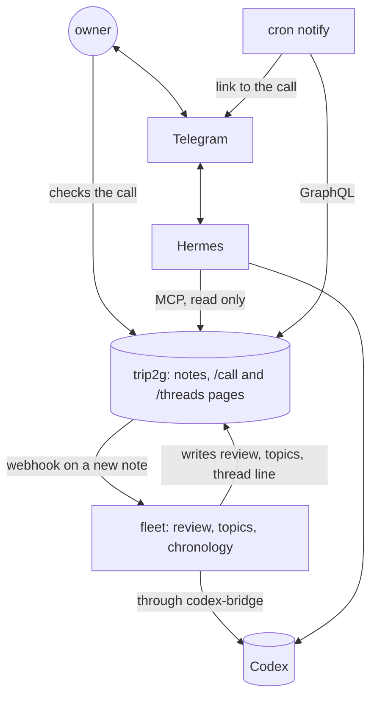

Two [[en/user/templates|layouts]] for a vault where calls are recorded, transcribed and reviewed: a timeline of long-running threads, and a screen where you check what was proposed about one call. Both read plain notes and write back with [[en/user/update_notes|updateNotes]]. Why they are built this way is in [[en/thoughts/calls-become-threads|Calls become threads]].

trip2g does not record, transcribe or review calls. Something else writes the transcript, review and topic-map notes: a recorder that saves into the vault, a script, or an agent with an [[en/user/graphql#Admin access via API key|API key]]. The two layouts read those notes. They write only the edits note of a call, the `hidden` key of a thread, and a person note when you add someone new.

- [[en/user/calls-threads-demo|▶ Threads demo]]
- [[en/user/calls-call-demo|▶ One-call demo]]

The demos run on invented data. A visitor can click everything, but changes stay in the tab; the site owner's changes are saved to the notes. The demo notes carry `search: false` on purpose, so the invented calls stay out of the site's search.

## A ready stand: an agent reviews calls and answers in Telegram

The [trip2g/call_dashboard](https://github.com/trip2g/call_dashboard) repository brings the whole thing up with one `docker compose`: trip2g with these layouts, fleet with three roles, and a [Hermes](https://github.com/NousResearch/hermes-agent) agent with a Telegram bot. The models are Codex on a ChatGPT plan. Who does what:

- **trip2g** stores the notes, draws the `/call` and `/threads` pages, calls a webhook when a note changes, and serves the vault over [[en/user/mcp|MCP]] and GraphQL. It does not review calls itself.
- **fleet** ([[en/user/fleet|roles]] are notes in `roles/`) does the reviewing: the `review` role writes the review of a new transcript, `topics` the topic map, `chronology` a line in a thread once you have checked the call and picked the thread.
- **Hermes** answers questions about calls and threads in Telegram. It reads the vault through trip2g's MCP as its knowledge base and cannot write to it. Every answer about a call ends with the call's page, every answer about a thread with the threads page.
- **A notify script** runs on cron every minute, looks for new reviews over GraphQL and sends the call's link to Telegram. It does not call a model.
- **codex-bridge** turns fleet's chat-completions calls into Codex Responses API calls with the ChatGPT login Hermes keeps.



![[calls-telegram.png|The bot answers about a call and a thread; each answer ends with a dashboard link]]

The stand's history is prepared: eleven past calls, their reviews and eight threads ship in the repository as ready notes. What is reviewed live is a call you add yourself; the repository has a sample transcript where the recorder labelled the client with someone else's name.

## Install

Copy three files from [`docs/_layouts/calls/`](https://github.com/trip2g/trip2g/tree/main/docs/_layouts/calls) into your vault's `_layouts/calls/`: `threads.html`, `call.html` and `frontmatter.js`. Then make a note for each page:

```yaml
---
title: Threads
layout: calls/threads
---
```

```yaml
---
title: Call
layout: calls/call
owner: Dana Whitfield
---
```

The body of the page note is shown under the title.

## The notes the pages read

| Note | Default folder | What it holds |
|---|---|---|
| Transcript | `transcripts/` | `Speaker \| MM:SS` lines, each followed by what was said. Optional `title` and `duration_min` in frontmatter |
| Review | `calls/` | `type: review`, `transcript:` path, `speakers:` map from label to name, optional `speakers_confidence:` (`unknown` marks a label), `assumed: true` when the speakers or topics were guessed, optional `date:` (without it, the date in the transcript's path, then in the review's). The first line of the body is the agenda |
| Topic map | `topics/` | Same file name as the review. Optional `title`, shown as the call's name instead of the agenda. A summary paragraph, then a `## Topics` section of `MM:SS \| topic` lines |
| Thread | `threads/` | `type: thread`, `group`, `kind`, `status`, `people`, `aliases`, optional `priority` and `hidden`, optional `last` date that orders a thread whose chronology links no call yet. A `## Chronology` list, one line per call, and a `## Open items` list |
| Person | `people/` | One note per person; its title is the name. `confirmed: false` marks a guess. A file whose name starts with `_` is skipped |
| Category | `categories/` | `type: call-category`, `order`, optional `kind` (`client` turns on the sales score) |
| Edits | `call_edits/` | Written by the one-call page, one note per call |

A call's id is the file name of its review note. The topic map and the edits note use the same name.

A chronology line starts with a link to the call, labelled with its date:

```markdown
## Chronology

- [[calls/c8e1a5|2026-07-31]]: Tax due on the 25th.
  Decided: depreciate the roaster. Open: send the invoice.
- 2026-10-01: The accountant sent a template by email.
```

A line that links to a review or a transcript is a dot on the timeline, dated by the link's text. A line without one, such as a letter or a decision made outside a call, appears in the thread's chain but not as a dot. `Decided:` and `Open:` start new lines in the side panel. The headings and these words are settings; the Russian demo uses «Хронология», «Решили:» and «Открыто:».

## Threads page settings

| Key | Default | Meaning |
|---|---|---|
| `threads` | `threads/*` | Glob of thread notes |
| `reviews`, `transcripts` | `calls/*`, `transcripts/*` | Globs that tell a call link from any other link |
| `thread_type` | `thread` | The `type` a thread note carries |
| `chronology_heading` | `Chronology` | Heading of the chronology list |
| `open_heading` | `Open items` | Heading of the open items list |
| `outcome_labels` | `[Decided, Open]` | Words that start a new line in the chain |
| `groups` | empty | Order of the groups; without it, groups follow their top thread: by priority first, then by activity |
| `stale_days` | `21` | Days without a call after which a thread is quiet |
| `span_months` | `3` | Months shown on open |
| `today` | the current date | Fixes "today", for a demo |
| `locale` | `en` | Dates, month names and plural forms |
| `ui` | English | Interface strings, see below |

Inside a group, threads are sorted by `priority`, then by activity: recent calls weigh more, and the weight halves every three weeks without a call. **Hide thread** sets `hidden: true` in the thread's frontmatter; **Hidden** in the toolbar shows hidden threads again.

## One-call page settings

| Key | Default | Meaning |
|---|---|---|
| `owner` | empty | Your name as it appears in `speakers`; that label shows "this is you" |
| `reviews`, `topics`, `transcripts` | `calls/*`, `topics/*`, `transcripts/*` | Globs |
| `people`, `threads`, `categories` | `people/**`, `threads/*`, `categories/*` | Globs |
| `edits` | `call_edits` | Folder for the edits notes |
| `people_folder` | `people` | Where **+ new person** creates a note |
| `review_type`, `thread_type`, `category_type` | `review`, `thread`, `call-category` | The `type` values the page looks for |
| `topics_heading` | `Topics` | Heading of the topic map section |
| `topic_line` | `{tc} \| {text}` | Shape of a topic line |
| `transcript_line` | `{who} \| {tc}` | Shape of a transcript speaker line |
| `pending_since` | empty | Date; transcripts from it on that have no review are listed as waiting |
| `transcripts_inline` | `false` | Put every transcript into the page instead of loading it on demand |
| `scores` | three scores | List of `key`, `label` and optional `only_kind` |
| `subgraph` | empty | Added to the notes the page creates, see [[en/user/subgraphs]] |
| `locale`, `ui` | `en`, English | As above |

A call counts as **waiting for your check** while it has `assumed: true` and its edits note lacks any of the four `verified` marks: speakers, category, threads, topics. **All verified** sets all four and opens the next call that waits.

Edits save themselves a second after the last change. The page keeps them in `call_edits/<id>.md`, never in the review: the review belongs to whoever wrote it, and the edits note belongs to the page. Saving checks the note's hash first, so an edit made elsewhere in the meantime is not overwritten.

Transcripts are loaded one at a time with the `ReadNote` query, which is the `notePaths` query from [[en/user/spa#Read a note's markdown|Read a note's markdown]]. From the page, only the site admin's session can call it, so a public demo sets `transcripts_inline: true` instead.

## The edits note

The one-call page writes `call_edits/<id>.md`, one note per call. Its frontmatter is the contract for anything that reads your checks:

| Key | Holds |
|---|---|
| `call` | The call's id |
| `review` | Path of the review note |
| `category` | Path of the category note |
| `speakers` | Map from a speaker label to the path of a person note |
| `threads` | Paths of the thread notes the call belongs to |
| `topics_wrong` | Timecodes of the topics marked wrong |
| `topic_threads` | Map from a topic's timecode to a thread path |
| `extra_topics` | Topics that were missed, one string each |
| `scores` | Map from a score key to a number from 1 to 10 |
| `outcome` | What was decided and what stayed open, as text |
| `verified` | Which of `speakers`, `category`, `threads` and `topics` you checked |
| `updated` | Time of the last save |

The body repeats the same in readable form. The demo has one: [[demo/calls/en/edits/c4f9a8|the edits note of the staging review]]. Nothing in trip2g reads it back into the review. Whatever writes the reviews can read it on its next pass: take the speaker you picked, drop a topic you marked wrong, add the chronology line for a thread you chose. That reader is yours to build.

## Interface language

Every string has an English default. To translate, list the keys under `ui` in the page note; the Russian demo pages carry the full list. A count takes plural forms:

```yaml
locale: ru
ui:
  search: "Найти нить"
  calls:
    one: "{n} встреча"
    few: "{n} встречи"
    many: "{n} встреч"
    other: "{n} встречи"
```

The forms follow `Intl.PluralRules` for the `locale`.

## Limits

- The page puts every review, thread and topic map matched by its globs into the HTML. A few hundred calls are fine; thousands are slow.
- The layouts read frontmatter in the browser with a small parser (`frontmatter.js`): maps, lists and `|` / `>` blocks, no anchors or tags.
- Nothing links a call to a thread automatically. The one-call page lists the threads whose notes link to that call, and saves the threads you pick in the edits note; whatever keeps the thread notes adds the chronology line.
- A save takes two requests: it reads the edits note's hash, then writes. Closing the tab within a second of an edit makes the browser ask you to stay; leaving anyway can lose that last edit.
