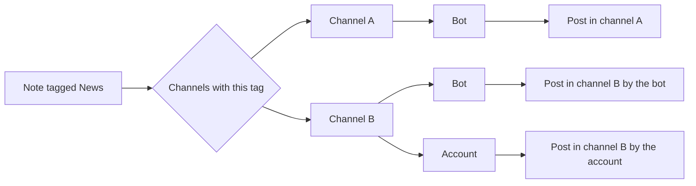

trip2g publishes posts through bots by default. It can also publish as an ordinary Telegram account. This page says what an account adds over a bot, how a note reaches a channel through one, and what stays fixed after a post is out. Read it if your posts need custom emoji or photo captions longer than a bot allows. If neither applies, a bot is enough.

Connecting a personal account carries its own risk: read [[en/telegram_account_risks|Telegram account risks]] first.

### What an account adds

A bot has two limits that matter here:

- A caption under a photo or an album is at most 1,024 characters.
- Custom emoji are not available.

An account changes them only when it has Telegram Premium:

| | Bot | Account | Premium account |
|---|---|---|---|
| Caption under a photo or album | 1,024 | 1,024 | Telegram's Premium limit |
| Custom emoji | no | no | yes |
| Setup | a bot token | sign in with the account | sign in with the account |

trip2g does not hard-code the caption limit for accounts. It reads the value Telegram reports for that account and applies it. Premium status is detected when you connect the account and re-checked on a schedule, so there is nothing to switch by hand.

### How a note reaches a channel

Tags route posts, the same way they do for bots.

- **One tag, several channels.** A note tagged `News` goes to every channel that carries this tag.
- **A channel can be linked to a bot and to an account at once.** The post is then sent through both.
- **Instant Tags** publish right after a sync. Use them for a [[en/user/telegram-instant|preview in a test channel]].
- **Regular tags** publish on the schedule set in `telegram_publish_at`.

### What you cannot change after publishing

- Photos and videos. This is Telegram's limit, not trip2g's.
- The post type. A text post does not become a post with media.

To change the media:

1. Open the post in the admin panel and click **Reset**. The post is deleted from the channel.
2. Edit the note and sync.
3. The post is published again on its schedule.

### Bot or account

Start with a bot: it needs only a token. Connect a Premium account when a post needs a longer caption or custom emoji.

### Related

- [[en/user/telegram|Telegram publishing]] — set up a bot, connect a channel, schedule a post
- [[en/user/telegram-emoji|Custom emoji]] — how to put custom emoji into a note
- [[en/telegram_account_risks|Telegram account risks]] — what can happen to an account connected through a third-party client
