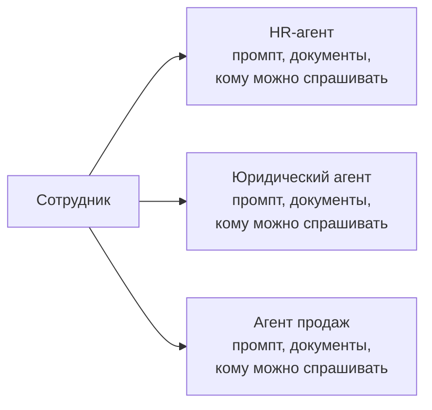
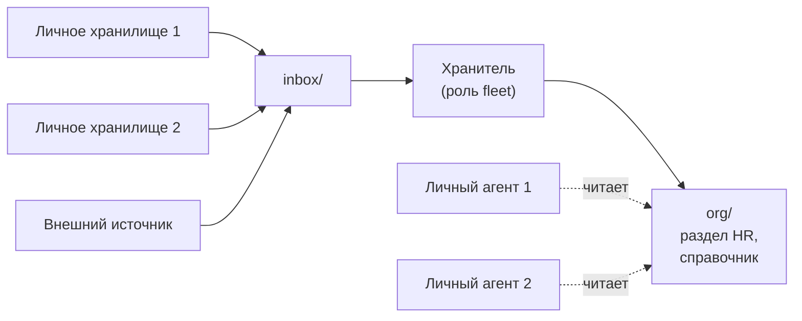

# В общее место никто не пишет

*Что это: как устроена база знаний компании, если в общее пространство никто не пишет. Каждый пишет в своё хранилище, агент-хранитель собирает уровень выше, а функция вроде HR оказывается разделом с доступом. Заодно отмечаю, где trip2g это умеет, где нет и где мой собственный конвейер нарушает правило. Читайте, если решаете, что класть в общую базу и кто её читает. Если всё, что у вас есть, пишет один человек, хватит текста [[ru/thoughts/one-writer-per-base]].*

## Схема, где на каждую функцию свой агент

Когда компания рисует, как у неё будет работать ИИ, первая схема обычно выглядит так: по блоку на функцию. HR-агент, юридический агент, агент продаж. У каждого блока промпт, стопка документов и список тех, кому можно его спрашивать.



*Первая схема: на каждую функцию свой агент.*

Разберите блок «HR-агент», и в нём окажется четыре вещи.

**Документы.** Положение об отпусках, чек-лист онбординга, зарплатные вилки. Им место в базе.

**Правила ответа.** «Политику цитируй, вилки не пересказывай». Им тоже место в базе. trip2g отдаёт их любому подключившемуся агенту как [[ru/user/instructions_guide|заметку с инструкциями]].

**Список, кому что можно спрашивать.** Это доступ на чтение, и в базе он уже есть.

**Действия.** Если HR-агент оформляет заявление на отпуск, эта часть — инструмент, и здесь его ничто не заменяет.

Три вещи из четырёх — это база знаний с приделанным окном чата. У того, кто спрашивает, агент обычно уже есть: в редакторе, в терминале или в мессенджере. Кому агента не дали, тому нужно одно окно чата, направленное на хаб с его собственным доступом, а не по окну на функцию.

Значит, функция HR — это раздел и правило доступа. Агент со схемы не исчезает. Он переходит с ответов на запись.

## Домен там, где меняется автор

Сколько заводить баз? Я считаю авторов.

[[ru/thoughts/one-writer-per-base|У базы один автор]]: её владелец, человек или его агент. Остальные читают. Тогда домен — не тема и не отдел. Домен там, где меняется автор. Один автор у HR и у инженерного справочника — это один домен с двумя разделами. Два автора — два домена, что бы ни было нарисовано в оргструктуре.

| Вопрос | Что на него отвечает |
|---|---|
| Кто пишет? | База на каждого автора |
| Кому можно в ней искать? | Ребро федерации между базами |
| Что они видят? | Подграфы внутри базы |

Две строки про чтение описаны в [[ru/user/context-separation]]. Строку про запись компании обычно проваливают первой: начинают с одной базы на всех.

Сколько в компании авторов, решает не софт. Это решают те, кто внедряет, и руководители команд. Один автор на всю организацию — тоже ответ.

## Хранитель

Страницы компании люди не пишут. Они пишут себе: заметки, расшифровки звонков, черновики, полмысли перед встречей. Личное хранилище — это свалка, и это нормально: у неё один хозяин, и он знает, что в ней лежит.

У уровня выше тоже есть автор, и это агент. Я называю его хранителем. Он читает то, что люди решили отдать, читает внешние источники и пишет собранные страницы. Хранитель один на автора, а не на функцию.



*Вторая схема: люди пишут себе, хранитель пишет собранные страницы, личные агенты читают их со своим доступом.*

В trip2g хранитель — это роль [[ru/user/fleet|fleet]], а роль — это заметка. Во frontmatter сказано, что роль может читать, что может писать и что её будит. В теле — инструкция.

```yaml
---
fleet_id: main
model: gpt-5.4-mini
tools: [search, read_note, write_note]
read_patterns: ["inbox/**", "org/**"]
write_patterns: ["org/**"]
mode: change
trigger_on: [create, update]
trigger_include: ["inbox/**"]
---
```

Рантайм проверяет `read_patterns` и `write_patterns` на каждом вызове. Хранитель с `write_patterns: ["org/**"]` больше никуда не запишет.

Теперь ограничение. Роль fleet читает и пишет внутри одного хаба. Поэтому `inbox/` и `org/` — папки одного инстанса, и свалки должны туда как-то попасть. В один инстанс можно синхронизировать несколько хранилищ, каждое под своей меткой ([[ru/user/advanced|документация]]). Человек может перенести заметку руками. Внешний агент может записать её через [[ru/user/update_notes|`updateNotes`]] или sync CLI. Роль с кодом может по расписанию забирать данные из внешнего API. Список не полон, и хаб ничего из этого не предписывает.

Чего в поставке нет: роли fleet, которая читает базу на другом инстансе. Федерация даёт агенту искать у соседа. Хранителя она не кормит.

## Три правила, и одно мой конвейер нарушает

Три вещи должны оставаться верными при любом способе доставки.

**Собранные страницы пишет только хранитель.** Как только их начинают править руками, это снова общая вики.

**Собранная страница называет источник.** В [[ru/thoughts/federation-supply-chain]] я смотрел, как модель ищет по одной слитой куче, находит верную мысль и вкладывает её не в те уста.

**Правка идёт в источник.** Если собранная страница врёт, значит, врёт расшифровка, личная заметка или роль. Чините их, а хранитель пересоберёт.

Хранитель, которого я могу показать, — [[ru/user/calls-knowledge-base|конвейер звонков]]. Три роли работают цепочкой. Первая забирает расшифровки звонков у сервиса записи и пишет каждую дословно. Вторая размечает границы тем. Третья вытаскивает людей, инструменты, проекты и термины и пишет на каждого заметку. В демо-прогоне заметка о проекте «Hermes» собрала три упоминания из трёх разных звонков. Эту заметку никто не писал. Она выросла.

Второе правило он держит цитатой. Под каждой темой стоят дословные строки расшифровки и таймкод со ссылкой обратно.

Первое он нарушает. В его же документации шаг проверки звучит так: исправьте заголовки у заметок с `needs_review`; конвейер дописывает, вы правите. Это моя рука в собранных страницах. Работает это потому, что конвейер только дописывает и тело заметки не переписывает, так что мою правку он не затрёт. Но это тот самый ход из общей вики, по одному заголовку за раз, и в источник я эту правку не перенёс.

## Сколько это стоит

Собранный уровень отстаёт. Он свеж ровно настолько, насколько свеж последний запуск хранителя.

Внутри одного инстанса единственный автор — это договорённость. API-ключ достаёт до всего инстанса, и ничто не мешает человеку записать в `org/`. Гарантия есть только между инстансами, где сосед может лишь читать, и именно туда хранитель пока не дотягивается.

В личной свалке лежит личное. Что видит хранитель, задают `read_patterns` роли, и кто-то должен выставить их сознательно. По умолчанию должно быть «ничего».

Хаб записывает, какой пользователь или API-ключ написал каждую версию заметки. Из какого источника взято предложение, он не записывает. Держать эту связь — работа роли, и роль, которая пересказывает без цитаты, её теряет.

Агент на функцию — это ещё и одно место, где видно, о чём спрашивают HR. От этого я отказываюсь.

Цена самого правила одного автора — потерянная правка мимоходом и общий черновик — разобрана в [[ru/thoughts/one-writer-per-base|том эссе]], повторять её не буду.

Размен одной строкой: вы отказываетесь от страницы, которую может править каждый. Взамен получаете базу компании, где у каждого предложения есть хозяин, и HR, который сводится к одному разделу и одному правилу доступа.
