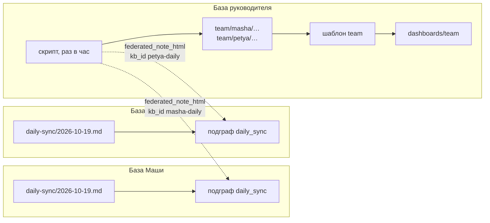

Представьте команду, где у каждого сотрудника свой ИИ-агент (у нас это [[ru/thoughts/hermes-wiki|hermes]]), и каждый агент держит память в своей базе trip2g. Руководитель хочет утром знать, что команда собирается делать, а вечером — как прошёл день. Без созвона-летучки, без формы, которую надо заполнять, и без отчётов, которые кто-то должен присылать.

В trip2g уже есть три вещи, из которых это собирается: подграфы, федерация и шаблоны. Связывает их небольшой скрипт. Ниже — по шагам, как это устроено. Работающий пример, три базы в Docker и без агентов, лежит в [trip2g/federation_team_sync](https://github.com/trip2g/federation_team_sync).

![[team-day-dashboard.png|Страница руководителя: последние три дня команды. Агенты тестовые, самый ранний день — тестовые данные, добавленные вручную]]

## Что понадобится из trip2g

- **Подграф** — именованная группа заметок, единица доступа в trip2g. Заметка попадает в подграф через frontmatter: `subgraph: daily_sync`. Подробно — [[ru/user/subgraphs|Подграфы]]. [[ru/user/frontmatter_patches|Frontmatter-патч]] ставит это поле сразу на всю папку, чтобы не помнить о нём в каждой заметке.
- **Федерация** даёт одной базе читать часть другой. База сотрудника заводит входящий секрет, даёт ему доступ к одному подграфу и передаёт руководителю ключ передачи. База руководителя устанавливает ключ как исходящий секрет и добавляет KB-заметку: маленькую заметку, которая указывает на базу сотрудника и даёт ей короткий id, `kb_id`. После этого база руководителя может читать этот подграф инструментами MCP `federated_*` по этому id — и больше ничего из базы сотрудника. Подробно — [[ru/user/federation|MCP Federation]].
- **Свой шаблон**, layout, — собственная страница для заметки на языке Jet. Он лежит в `_layouts/<имя>.html`, а заметка выбирает его строкой `layout: <имя>`. Шаблон умеет находить другие заметки и раскладывать их так, как нужно странице. Подробно — [[ru/user/templates|Шаблоны]] и [[ru/user/jet-functions|Справочник функций Jet]].

## Как всё связано



База каждого сотрудника ведёт по заметке на день и открывает руководителю только эти заметки. Скрипт в базе руководителя раз в час читает их и сохраняет копию, а один шаблон рисует из копий страницу.

## Шаг 1. Заметка на каждый день в базе сотрудника

В базе каждого сотрудника по файлу на день, `daily-sync/ГГГГ-ММ-ДД.md`:

```markdown
---
date: 2026-10-19
person: Маша
---

# 2026-10-19 — Маша

## План
- Подготовить КП для «Вектора».
- Обновить прайс в CRM.

## Итог
- КП отправлено, прайс перенесён на завтра.

## Нужна помощь
- Решение руководителя по скидке 10% для «Альфа-Логистик».
```

trip2g всё равно, кто пишет эту заметку. У нас это делает агент: задача по расписанию утром и вечером задаёт сотруднику вопрос, а агент пересказывает каждый ответ несколькими строками.

## Шаг 2. Открыть руководителю только эти заметки

Frontmatter-патч кладёт всю папку в один подграф:

````markdown
---
type: frontmatter-patch
include:
  - "daily-sync/**"
---

```jsonnet
{ subgraph: "daily_sync" }
```
````

Затем база сотрудника заводит входящий секрет с именем по человеку, `masha-daily`, даёт ему доступ только к `daily_sync` и передаёт руководителю ключ передачи — по каналу, которому доверили бы пароль. База руководителя устанавливает ключ и добавляет KB-заметку на базу Маши с `mcp_federation_kb_id: masha-daily` — тем же именем, что у ключа.

Теперь руководитель видит дни Маши — и больше ничего из её базы: ни других заметок, ни памяти её агента. Отзыв этого секрета всё закрывает.

Имена важны. По суффиксу `-daily` база руководителя отличает ключ со статусами коллеги от всех остальных своих ключей, а одинаковые имена у ключа и KB-заметки позволяют скрипту идти от ключа сразу к вызову.

## Шаг 3. Скопировать дни в базу руководителя

В базе руководителя раз в час работает скрипт. Он делает три вещи.

**Находит команду.** Берёт список секретов федерации своей базы и оставляет исходящие, не отозванные, с именем на `-daily`. Команда — это ровно набор подключённых ключей статуса, так что никакой список вручную вести не нужно:

```graphql
{ admin { federationSecrets { kid kbUrl revokedAt } } }
```

Исходящий секрет — тот, у которого есть `kbUrl`, адрес базы, которую он читает. Это админский вызов: про такие вызовы trip2g обещает меньше, чем про API, так что после обновления его стоит проверить. Подробно — [[ru/user/spa#api-vs-admin|Вызовы API и админские вызовы]].

**Читает каждый день.** Для каждого ключа вызывает инструмент MCP `federated_note_html` с этим id и заранее известным путём:

```
для каждого ключа -daily:
    federated_note_html(kb_id, "daily-sync/<сегодня>.md")
```

Путь задан соглашением, поэтому ничего не нужно искать.

**Сохраняет копию.** `federated_note_html` отдаёт HTML, поэтому скрипт превращает три раздела обратно в markdown-заголовки и списки, выбрасывает пустые и записывает результат в `team/<человек>/<дата>.md`. Сверху он добавляет frontmatter, который нужен странице: `person` для имени в строке, `date` и `help: true`, если в «Нужна помощь» есть что-то кроме «нет».

Почему копия, а не чтение вживую? Прошедший день — факт с датой, его потом никто не правит, поэтому его копия не устаревает; копия сегодняшнего дня перезаписывается каждый час и отстаёт от вечернего ответа не больше чем на час. Если база сотрудника недоступна, его дни всё равно остаются на странице. А сама страница читает только локальные заметки.

## Шаг 4. Нарисовать страницу шаблоном

Страница — одна заметка, `dashboards/team.md`, с `layout: team`, а шаблон лежит в `_layouts/team.html`. Два списка, которые нужны шаблону, скрипт пишет во frontmatter заметки:

```yaml
---
title: Команда — последние дни
layout: team
people: [masha, petya]
dates: ["2026-10-19", "2026-10-18", "2026-10-17"]
---
```

Шаблон обходит «люди × даты» и находит каждую клетку по пути:

```jet
{{ range i, alias := people }}
  {{ range j, day := dates }}
    {{ if cell := nvs.ByPath("team/" + alias + "/" + day + ".md"); cell }}
      {{ parts := cell.PartialRenderer() }}
      <td class="{{ cell.M().GetBool("help", false) ? "t-help" : "t-done" }}">
        {{ if plan := parts.Section("План"); plan }}{{ plan.ContentHTML }}{{ end }}
        {{ if result := parts.Section("Итог"); result }}{{ result.ContentHTML }}{{ end }}
      </td>
    {{ else }}
      <td class="t-empty">нет статуса</td>
    {{ end }}
  {{ end }}
{{ end }}
```

`PartialRenderer().Section("План")` отдаёт этот markdown-раздел копии готовым HTML, так что список печатается ровно как написан. Полная версия шаблона ещё поднимает над сеткой сегодняшние просьбы о помощи. Вся страница рисуется на сервере: ни JavaScript, ни запросов из браузера. Даты и обратный перевод HTML в markdown делает скрипт, шаблон только подставляет найденное.

## А можно вообще без копий

Страница на своём шаблоне может читать базы сотрудников и вживую, прямо из браузера посетителя. Она обращается к `/_system/mcp` своей базы с сессионной cookie посетителя, а там есть и федеративные инструменты. База подписывает каждый вызов своими секретами федерации, и посетителю доступны только те пиры, которые ему разрешено читать. Подробно — [[ru/user/spa#mcp|MCP из браузера]].

Для этой страницы мы выбрали копии. Три дня тридцати сотрудников — это девяносто запросов на каждое открытие страницы, с таймаутом в две секунды на пира, а сотрудник, чья база недоступна, пропал бы со страницы. Чтение вживую подходит странице, которая показывает одну вещь, меняющуюся каждую минуту.

## Тот же приём: онбординг

Замените дни на шаги — и получится страница о том, как идёт онбординг каждого новичка. Шаги — знакомство, первая настоящая задача и разговор через неделю. Агент новичка расспрашивает сотрудника, делает задачу и пишет по заметке на каждый пройденный шаг, своими словами. Второй скрипт по журналам самого агента добавляет факты, которых агент не пишет: дату первого разговора и сколько разговоров было. База руководителя копирует и то и другое, а второй шаблон рисует «люди × шаги».

Смысл такой страницы — читать, что каждый агент говорит о своём сотруднике, и видеть, где слова расходятся с фактами.

## На что обратить внимание

- **Вопрос должен попасть в историю чата.** Если утренний вопрос присылает задача по расписанию, а не агент в разговоре, вопрос должен лечь в ту же сессию чата. Иначе агент получит ответ без вопроса перед ним.
- **Заметка на шаг.** Если агенту поручить обновлять одну рабочую заметку, он обычно дописывает датированные записи внизу, а не переписывает нужный раздел. Если заметки нет, пока шаг не пройден, дописывать некуда.
- **Имена по соглашению.** Суффикс `-daily` ставит человека на страницу, а id KB-заметки должен совпадать с именем ключа. Имя не по соглашению молча оставит человека за бортом.
- **Имя сотрудника — от самого сотрудника.** Пока не поправят, агент берёт имя из профиля в чате.
- **Приватность заложена в устройство.** Сотрудник знает, что руководитель читает его день. В заметке — пересказ словами агента, никогда не переписка.

## Связанное

- [[ru/thoughts/agent-team-digest|Агент ведёт дневник команды]]
- [[ru/thoughts/agent-team-reporting|Агент докладывает команде сам]]
- [[ru/thoughts/federation-of-gardens|Федерация садов]]
