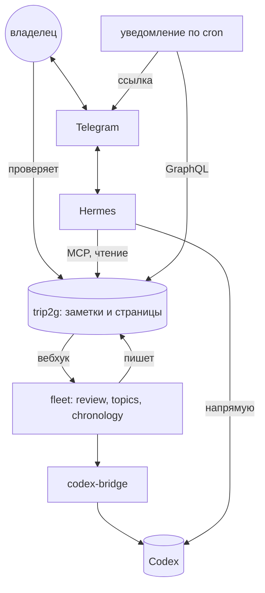

Два [[ru/user/templates|макета]] для базы, куда попадают записанные, расшифрованные и разобранные созвоны: таймлайн долгих нитей и экран, где вы проверяете, что предложено по одному созвону. Оба читают обычные заметки и пишут обратно через [[ru/user/update_notes|updateNotes]]. Почему они устроены так, рассказано в эссе [[ru/thoughts/calls-become-threads|Созвоны превращаются в нити]].

trip2g не записывает, не расшифровывает и не разбирает созвоны. Транскрипт, разбор и карту тем пишет что-то другое: диктофон, который сохраняет в базу, скрипт или агент с [[ru/user/graphql#Административный доступ через API-ключ|API-ключом]]. Оба макета эти заметки читают. Пишут они только заметку правок созвона, ключ `hidden` у нити и заметку человека, когда вы добавляете нового.

- [[ru/user/calls-threads-demo|▶ Демо нитей]]
- [[ru/user/calls-call-demo|▶ Демо одного созвона]]

Демо работают на выдуманных данных. Посетитель может нажимать всё, но изменения остаются во вкладке; изменения владельца сайта записываются в заметки. У демо-заметок намеренно стоит `search: false`, чтобы выдуманные созвоны не попадали в поиск по сайту.

## Готовый стенд: агент разбирает созвоны и отвечает в Telegram

Репозиторий [trip2g/call_dashboard](https://github.com/trip2g/call_dashboard) поднимает всё целиком одним `docker compose`: trip2g с этими макетами, fleet с тремя ролями и агента [Hermes](https://github.com/NousResearch/hermes-agent) с ботом в Telegram. Модели — Codex по подписке ChatGPT. Кто что делает:

- **trip2g** хранит заметки, рисует страницы `/call` и `/threads`, при изменении заметки вызывает вебхук и отдаёт базу по [[ru/user/mcp|MCP]] и GraphQL. Сам он созвоны не разбирает.
- **fleet** ([[ru/user/fleet|роли]] — заметки в `roles/`) разбирает: роль `review` пишет разбор нового транскрипта, `topics` — карту тем, `chronology` — строку в нить, когда вы проверили созвон и выбрали нить.
- **Hermes** отвечает в Telegram на вопросы о созвонах и нитях. Он читает базу через MCP trip2g как базу знаний и не может в неё писать. Каждый ответ о созвоне кончается ссылкой на страницу созвона, о нити — ссылкой на страницу нитей.
- **Скрипт уведомления** раз в минуту по cron смотрит новые разборы через GraphQL и присылает в Telegram ссылку на созвон. Модель он не вызывает.
- **codex-bridge** переводит вызовы chat completions от fleet в Codex Responses API с логином ChatGPT, который хранит Hermes.



![[calls-telegram.png|Бот отвечает о созвоне и о нити; каждый ответ кончается ссылкой на дашборд]]

История в стенде заготовлена: одиннадцать прошлых созвонов, их разборы и восемь нитей лежат в репозитории готовыми заметками. Вживую разбирается созвон, который вы добавите сами; в репозитории есть пример транскрипта, где диктофон подписал клиента чужим именем.

## Запись созвонов: Amanu

Созвоны можно записывать [Amanu](https://github.com/gsamat/amanu) — бесплатной программой с открытым кодом (MIT) для macOS и Windows. Она сама начинает запись, когда приложение звонка берёт микрофон, и останавливает её, когда звонок кончается. Микрофон и собеседник пишутся в разные каналы, поэтому в транскрипте стороны разделены: `me` и `them`. Расшифровка идёт локально, звук никуда не уходит.

Как Amanu попадает в trip2g:

1. Скачайте стартовый архив со своего инстанса и распакуйте его. Это готовое хранилище Obsidian: плагин синхронизации уже настроен, ключ API лежит в нём же.
2. В настройках Amanu укажите `recordings_dir` внутри этого хранилища и включите `keep_audio`, чтобы звук остался для плеера.
3. В `on_stop` поставьте хук [amanu-to-trip2g.mjs](https://github.com/trip2g/call_dashboard/tree/main/amanu) с абсолютным путём к `node`. После каждой встречи он пишет `transcripts/<дата>-<id>.md` в формате, который читают роли и страница созвона, вставляет запись звонка и запускает синхронизацию. Имена, которые угадала Amanu, уходят только подсказкой: кто говорил, решаете вы на странице созвона.
4. Макет [`calls/transcript`](https://github.com/trip2g/call_dashboard/tree/main/vault/_layouts/calls) показывает транскрипт с плеером: клик по таймкоду ставит звук на нужную реплику.

Запись звонка весит около 0,5 МБ в минуту, поэтому поднимите `MAX_REQUEST_BODY_SIZE` хотя бы до 50 МБ, иначе звонки длиннее 20 минут не загрузятся.

### Какой движок выбрать

Один настоящий русский звонок, 40 минут, двое говорящих, MacBook на Apple M3 Max (48 ГБ). Точность мерили на пяти 30-секундных фрагментах (370 слов) против эталонной расшифровки Deepgram nova-3, а по всему звонку — против транскрипта Krisp.

| | Parakeet v3 | GigaAM v3 | Whisper large-v3-turbo | Krisp |
|---|---|---|---|---|
| Ошибки на фрагментах | 13,0% | **11,9%** | 25,4% | 22,4% |
| WER против Krisp, весь звонок | **19,8%** | 25,7% | 22,4% | — |
| Расшифровка 40 минут | **20 с** | **20 с** | 59–136 с | облако |
| Загрузка модели, один раз | 54 с | 17 с | 34 с | — |
| Память (RSS) | 0,3–0,5 ГБ | 0,4–0,6 ГБ | 1,0–1,4 ГБ | — |

Parakeet стоит в Amanu по умолчанию, и его стоит оставить: точность почти как у GigaAM, таймкоды точнее (96% реплик Krisp совпали по началу в пределах 3 секунд), считает на Neural Engine и не мешает работать. GigaAM — запасной вариант для русского. Whisper медленнее и ошибается вдвое чаще. Английские слова Parakeet пишет кириллицей («АИ-отдел»), Whisper оставляет латиницей.

Локальные движки не различают нескольких собеседников на одной стороне: если на той стороне трое, все они будут `them`.

## На своём сервере

В том же репозитории лежит [Ansible-плейбук](https://github.com/trip2g/call_dashboard/tree/main/ansible), который ставит весь стенд на пустой сервер с Ubuntu 24.04: trip2g, роли fleet, Hermes с ботом в Telegram и Caddy с HTTPS на вашем домене. Хватает самого дешёвого сервера: 2 ядра и 4 ГБ.

Плейбук написан для того, чтобы его запускал ИИ-агент, а не человек: в [`ansible/AGENTS.md`](https://github.com/trip2g/call_dashboard/blob/main/ansible/AGENTS.md) перечислено, что спросить у человека, какие команды выполнить, как проверить каждый шаг и что отдать человеку в конце. Агент, которому дали только ссылку на репозиторий и пустой сервер, поставил всё за 17 минут. Сам человек делает одно: вход в Codex в браузере.

Входа по паролю нет. Войти можно:

- по одноразовой ссылке: `docker compose exec -T trip2g /trip2g login-link` на сервере, ссылка живёт 5 минут;
- кнопкой в Telegram: напишите боту «дай ссылку для входа». Ссылка приходит кнопкой, а не текстом — модель, которая перепечатывает длинную ссылку, её портит;
- кодом на email, если подключить почту ([[ru/user/smtp|SMTP или Resend]]);
- через Google или GitHub ([[ru/user/oauth|OAuth]]).

Агент на сервере ведёт и свою базу: он сохраняет заметки и синхронизирует их с trip2g в обе стороны, так что правки с сайта возвращаются к нему.

## Установка

Скопируйте три файла из [`docs/_layouts/calls/`](https://github.com/trip2g/trip2g/tree/main/docs/_layouts/calls) в `_layouts/calls/` своей базы: `threads.html`, `call.html` и `frontmatter.js`. Потом заведите по заметке на страницу:

```yaml
---
title: Нити
layout: calls/threads
---
```

```yaml
---
title: Созвон
layout: calls/call
owner: Ольга Миронова
---
```

Текст заметки страницы показывается под заголовком.

## Какие заметки читают страницы

| Заметка | Папка по умолчанию | Что в ней |
|---|---|---|
| Транскрипт | `transcripts/` | Строки `Спикер \| MM:SS`, под каждой — что сказано. Во frontmatter можно `title` и `duration_min` |
| Разбор | `calls/` | `type: review`, путь `transcript:`, карта `speakers:` от метки к имени, по желанию `speakers_confidence:` (`unknown` отмечает метку), `assumed: true`, если спикеры или темы угаданы, по желанию `date:` (без него — дата из пути транскрипта, потом из пути разбора). Первая строка текста — повестка |
| Карта тем | `topics/` | То же имя файла, что у разбора. По желанию `title` — его страница показывает как название созвона вместо повестки. Абзац-сводка, потом раздел `## Topics` со строками `MM:SS \| тема` |
| Нить | `threads/` | `type: thread`, `group`, `kind`, `status`, `people`, `aliases`, по желанию `priority` и `hidden`, по желанию дата `last`, по которой сортируется нить, чья хронология ещё не ссылается ни на один созвон. Список `## Chronology`, по строке на созвон, и список `## Open items` |
| Человек | `people/` | По заметке на человека, заголовок — имя. `confirmed: false` отмечает догадку. Файл, чьё имя начинается с `_`, пропускается |
| Категория | `categories/` | `type: call-category`, `order`, по желанию `kind` (`client` включает оценку продажи) |
| Правки | `call_edits/` | Пишет страница одного созвона, по заметке на созвон |

Id созвона — имя файла его разбора. Карта тем и заметка правок называются так же.

Строка хронологии начинается со ссылки на созвон, подписанной датой:

```markdown
## Chronology

- [[calls/c8e1a5|2026-07-31]]: Налог до 25-го.
  Decided: амортизируем ростер. Open: отправить счёт.
- 2026-10-01: Бухгалтер прислал шаблон по почте.
```

Строка со ссылкой на разбор или транскрипт — точка на таймлайне, дата берётся из подписи ссылки. Строка без такой ссылки, например письмо или решение вне созвона, видна в цепочке нити, но точкой не становится. `Decided:` и `Open:` начинают новые строки в боковой панели. Заголовки и эти слова настраиваются, русское демо использует «Хронология», «Решили:» и «Открыто:».

## Настройки страницы нитей

| Ключ | По умолчанию | Значение |
|---|---|---|
| `threads` | `threads/*` | Glob заметок нитей |
| `reviews`, `transcripts` | `calls/*`, `transcripts/*` | Glob'ы, по которым ссылка на созвон отличается от остальных |
| `thread_type` | `thread` | `type` заметки нити |
| `chronology_heading` | `Chronology` | Заголовок списка хронологии |
| `open_heading` | `Open items` | Заголовок списка открытого |
| `outcome_labels` | `[Decided, Open]` | Слова, с которых в цепочке начинается новая строка |
| `groups` | пусто | Порядок групп; без него группы идут по своей верхней нити: сначала по приоритету, потом по активности |
| `stale_days` | `21` | Через сколько дней без созвона нить считается затихшей |
| `span_months` | `3` | Сколько месяцев видно при открытии |
| `today` | текущая дата | Фиксирует «сегодня», для демо |
| `locale` | `en` | Даты, названия месяцев и формы множественного числа |
| `ui` | английский | Строки интерфейса, см. ниже |

Внутри группы нити идут по `priority`, потом по активности: свежие созвоны весят больше, и вес вдвое падает за каждые три недели без созвона. **Скрыть нить** ставит `hidden: true` во frontmatter нити; галочка **Скрытые** в панели показывает их снова.

## Настройки страницы созвона

| Ключ | По умолчанию | Значение |
|---|---|---|
| `owner` | пусто | Ваше имя, как оно записано в `speakers`; у этой метки написано «это вы» |
| `reviews`, `topics`, `transcripts` | `calls/*`, `topics/*`, `transcripts/*` | Glob'ы |
| `people`, `threads`, `categories` | `people/**`, `threads/*`, `categories/*` | Glob'ы |
| `edits` | `call_edits` | Папка заметок правок |
| `people_folder` | `people` | Где **+ новый человек** создаёт заметку |
| `review_type`, `thread_type`, `category_type` | `review`, `thread`, `call-category` | Значения `type`, которые ищет страница |
| `topics_heading` | `Topics` | Заголовок раздела карты тем |
| `topic_line` | `{tc} \| {text}` | Вид строки темы |
| `transcript_line` | `{who} \| {tc}` | Вид строки спикера в транскрипте |
| `pending_since` | пусто | Дата; транскрипты с неё без разбора показываются как ждущие |
| `transcripts_inline` | `false` | Класть все транскрипты в страницу, а не загружать по одному |
| `scores` | три оценки | Список из `key`, `label` и необязательного `only_kind` |
| `subgraph` | пусто | Добавляется в заметки, которые создаёт страница, см. [[ru/user/subgraphs]] |
| `locale`, `ui` | `en`, английский | Как выше |

Созвон **ждёт вашей проверки**, пока у него `assumed: true` и в заметке правок нет хотя бы одной из четырёх отметок `verified`: спикеры, категория, нити, темы. **Всё проверено** ставит все четыре и открывает следующий ждущий созвон.

Правки сохраняются сами через секунду после последнего изменения. Страница держит их в `call_edits/<id>.md`, а не в разборе: разбор принадлежит тому, кто его написал, а заметка правок — странице. Перед записью страница сверяет хэш заметки, так что правка, сделанная тем временем в другом месте, не затирается.

Транскрипты загружаются по одному запросом `ReadNote` — это запрос `notePaths` из раздела [[ru/user/spa#Прочитать markdown заметки|Прочитать markdown заметки]]. Со страницы его может вызвать только сессия админа сайта, поэтому публичное демо вместо этого ставит `transcripts_inline: true`.

## Заметка правок

Страница созвона пишет `call_edits/<id>.md`, по заметке на созвон. Её frontmatter — договор для всего, что читает ваши проверки:

| Ключ | Что в нём |
|---|---|
| `call` | Id созвона |
| `review` | Путь заметки разбора |
| `category` | Путь заметки категории |
| `speakers` | Карта от метки спикера к пути заметки человека |
| `threads` | Пути заметок нитей, к которым относится созвон |
| `topics_wrong` | Таймкоды тем, отмеченных «не так» |
| `topic_threads` | Карта от таймкода темы к пути нити |
| `extra_topics` | Пропущенные темы, по строке на тему |
| `scores` | Карта от ключа оценки к числу от 1 до 10 |
| `outcome` | Что решили и что осталось открытым, текстом |
| `verified` | Что из `speakers`, `category`, `threads` и `topics` вы проверили |
| `updated` | Время последнего сохранения |

Текст заметки повторяет то же в читаемом виде. В демо есть одна такая: [[demo/calls/ru/edits/c4f9a8|заметка правок к просмотру магазина]]. Обратно в разбор её ничто в trip2g не переносит. То, что пишет разборы, может прочитать её на следующем проходе: взять выбранного вами спикера, выбросить тему, отмеченную «не так», дописать строку хронологии в выбранную нить. Этого читателя вы пишете сами.

## Язык интерфейса

У каждой строки есть английское значение по умолчанию. Чтобы перевести, перечислите ключи под `ui` в заметке страницы; русские демо-страницы содержат полный список. Для счётчиков задаются формы множественного числа:

```yaml
locale: ru
ui:
  search: "Найти нить"
  calls:
    one: "{n} встреча"
    few: "{n} встречи"
    many: "{n} встреч"
    other: "{n} встречи"
```

Формы выбираются по `Intl.PluralRules` для `locale`.

## Ограничения

- Страница кладёт в HTML все разборы, нити и карты тем, которые нашли её glob'ы. Несколько сотен созвонов — нормально, тысячи — медленно.
- Макеты читают frontmatter в браузере небольшим парсером (`frontmatter.js`): карты, списки и блоки `|` / `>`, без якорей и тегов.
- Созвон не привязывается к нити сам. Страница созвона показывает нити, чьи заметки ссылаются на этот созвон, и сохраняет выбранные вами нити в заметку правок; строку в хронологию добавляет то, что ведёт заметки нитей.
- Сохранение — это два запроса: сначала хэш заметки правок, потом запись. Если закрыть вкладку в течение секунды после правки, браузер спросит, точно ли уйти; если уйти всё равно, последняя правка может пропасть.
